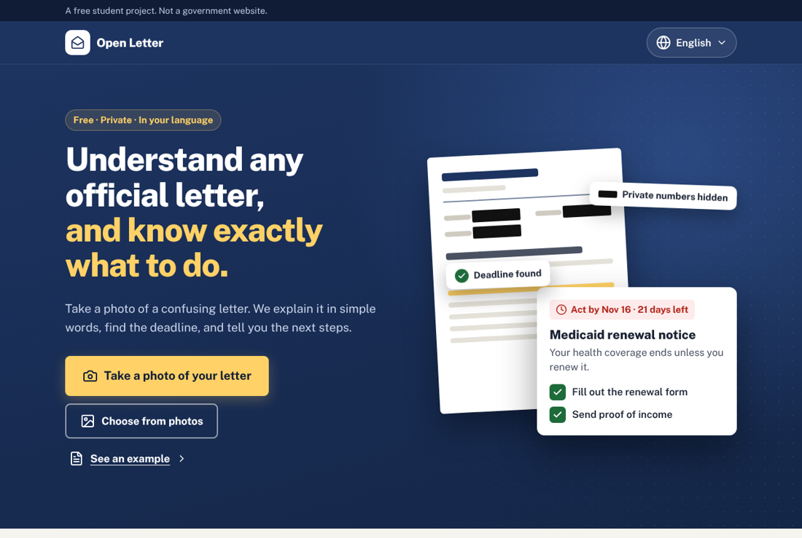
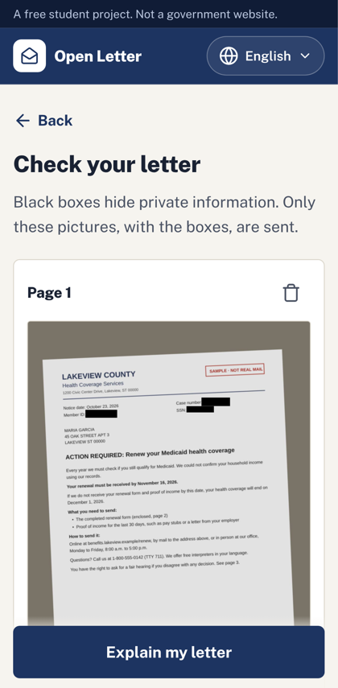
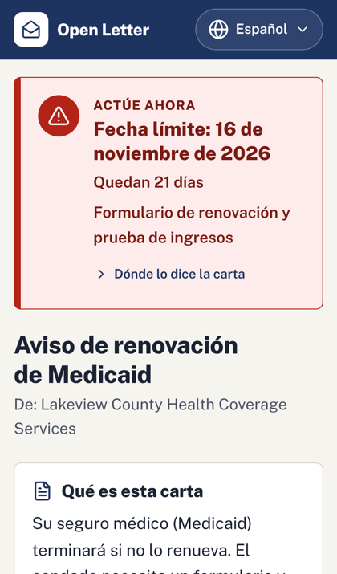
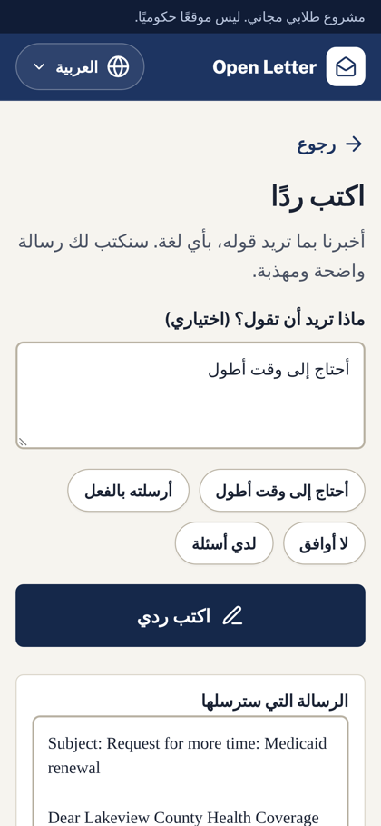

# Open Letter

**Understand any official letter in your language, and know exactly what to do.**

Take a photo of a confusing letter (a Medicaid renewal, an IRS notice, an eviction warning, a school form). Open Letter explains it in plain words, puts the deadline at the top, and turns the letter into a checklist. It works in English, Spanish, Chinese, Vietnamese, and Arabic.

**[Try it in your browser →](https://sheila-sil.github.io/open-letter/)** Tap **"See an example"**. No sign-up, no install.



## Why this exists

People lose health coverage, food benefits, and even their homes because a letter was confusing and a deadline slipped by. When a family doesn't read English well, a child often ends up translating official mail for their parents. Translation apps give you the words; Open Letter tells you what the letter **means** and what to **do**, and shows you where in the letter it found each answer, so you don't have to take the app's word for it.

| Hide private numbers | Get the explanation | Write a reply |
|---|---|---|
|  |  |  |

## What it does

- **Deadline first.** A banner with the due date and how many days are left, using color, an icon, *and* words, so it's clear even for people who are colorblind.
- **A checklist** of what to do, with a progress bar, plus **tap-to-call** phone numbers from the letter.
- **Every point shows its source.** Tap "Where the letter says this" to see the exact sentence. The app also checks each quote against the text it read from your photo and warns you if it can't find it.
- **Private numbers are hidden on your phone first.** Social Security, account, member, and case numbers are covered with black boxes *before* anything is uploaded. You can cover anything else (like your name and address) with your finger.
- **Scam warnings** for red flags like gift-card payments or threats of arrest.
- **Read aloud** in your language, **add a calendar reminder** three days before the deadline, and **share** the summary with family.
- **Reply helper.** Say what you want to tell the office, in any language. You get a polite letter in English, plus a translation so you know exactly what you're sending.
- **Five languages**, including right-to-left Arabic. Works on any phone or computer with a web browser.

## How to use it

1. Open the app and pick your language (top-right corner).
2. Tap **Take a photo of your letter**. Lay the letter flat, in good light. Add more pages if the letter has them.
3. Check the photo. Black boxes show what was hidden. Tap **Hide something** to cover anything else.
4. Tap **Explain my letter** and wait about a minute.
5. Start with the colored banner at the top: it tells you how urgent the letter is and when it's due.

> Open Letter can make mistakes and is not legal advice. Always confirm important details, especially dates, with the office that sent the letter.

## Privacy

- **On your phone:** reading the photo to find private numbers, covering them, and checking quotes all happen in your browser. That text never leaves your device.
- **Sent to the server:** only the photo *with the black boxes*. The server passes it to an AI service to be explained and never stores it.
- **The AI service:** by default this is Google Gemini's free tier. Google may keep what free-tier apps send and use it to improve its products. If you run your own copy, you can switch to a paid tier or to Anthropic's Claude (see [Settings](#settings)).

## Run your own copy

### Just the example (no AI key, nothing to install but Python)

```bash
git clone https://github.com/Sheila-Sil/open-letter
cd open-letter/frontend
python3 -m http.server 8000
```

Open http://localhost:8000 and tap "See an example." Any static web server works; the app just needs to be served over `http://`, not opened as a file.

### The full app, with AI

You need Python 3.10 or newer and a free Gemini API key from [Google AI Studio](https://aistudio.google.com/apikey). Google requires API account holders to be 18 or older, so younger students may need a parent or teacher to create the key.

```bash
git clone https://github.com/Sheila-Sil/open-letter
cd open-letter
python3 -m venv .venv
source .venv/bin/activate          # Windows: .venv\Scripts\activate
pip install -r requirements-dev.txt
cp .env.example .env               # then paste your key after GEMINI_API_KEY=
uvicorn backend.main:app --reload
```

Open http://localhost:8000. To try it on your phone, run `uvicorn backend.main:app --host 0.0.0.0` and open `http://<your-computer's-IP>:8000` on the same Wi-Fi. (Some phones only allow the camera on HTTPS sites; a deployed copy has HTTPS.)

### Put it online

- **Example only, free:** fork this repo, then go to **Settings → Pages** and set **Source** to **GitHub Actions**. The included workflow (`.github/workflows/pages.yml`) publishes the `frontend` folder every time you push to `main`.
- **Full app:** any host that runs Python works. On [Render](https://render.com), create a **Web Service** from your fork with build command `pip install -r requirements.txt`, start command `uvicorn backend.main:app --host 0.0.0.0 --port $PORT`, and an environment variable `GEMINI_API_KEY`.

### Settings

Put these in `.env` or in your host's environment variables. All are optional except the API key.

| Variable | Default | What it does |
|---|---|---|
| `GEMINI_API_KEY` | | Your Gemini key (needed when using Gemini) |
| `AI_PROVIDER` | `gemini` | `gemini` (free tier available) or `claude` (paid, Anthropic) |
| `ANTHROPIC_API_KEY` | | Your Anthropic key (needed when using Claude) |
| `OPEN_LETTER_MODEL` | `gemini-flash-latest` or `claude-opus-5-5` | Which AI model reads the letters |
| `OPEN_LETTER_EFFORT` | `medium` | Claude only: `low` is faster and cheaper, `high` thinks harder |
| `OPEN_LETTER_RATE_LIMIT` | `15` | Letters each visitor can send per 10 minutes, so one person can't use up your quota |

## How it works

```
Phone browser                                            Python server               AI (Gemini or Claude)
─────────────                                            ─────────────               ─────────────────────
photo ─► OCR finds private numbers ─► black boxes ─────► /api/decode ─────────────► reads the image and answers
         (tesseract.js, runs on                          checks it's a real image,   in a fixed JSON format
          the phone)                                     rate-limits, never saves it
                │                                                │
                ▼                                                ▼
         letter text stays on ──► checks every quote ◄── cleans phone numbers and links,
         the phone                in the answer           drops contacts from likely scams
```

- **The AI must answer in a fixed format** (structured output), described in `backend/schemas.py`. The instructions in `backend/prompts.py` require a word-for-word quote for every fact, forbid made-up phone numbers and dates, and tell the AI to treat anything written in the letter as content to explain, never as instructions to follow.
- **The app does its own date math.** The AI reports the deadline date; the app counts the days left. AI models are unreliable at arithmetic.
- **No build step.** The frontend is plain HTML, CSS, and JavaScript, so anyone can read it and change it.

```
backend/
  main.py        web routes, upload checks, rate limiting
  decoder.py     calls Gemini or Claude, then double-checks the answer
  prompts.py     instructions for the AI
  schemas.py     the exact shape of the AI's answer
frontend/
  index.html     every screen
  css/styles.css
  js/app.js      screens, buttons, talking to the server
  js/redact.js   finds and hides private numbers (on the phone)
  js/verify.js   checks quotes against the letter
  js/i18n.js     all text, in every language
  js/sample.js   the example letter
  vendor/        bundled OCR, so no CDN is needed
tests/           server tests (pytest) and redaction tests (node)
```

## Tests

```bash
python -m pytest                     # server: uploads, errors, rate limits, link cleaning (the AI is faked, so it's free)
node --test tests/redact.test.mjs    # private-number detection and quote checking
```

## Contributing

Help is very welcome, especially with:

- **Reviewing translations.** The Spanish, Chinese, Vietnamese, and Arabic text was machine-assisted. If you're a native speaker, please read through the app in your language and open an issue or pull request with fixes. All the text is in `frontend/js/i18n.js`.
- **Adding a language.** Add it to `LANGS` and `STRINGS` in `frontend/js/i18n.js` and to `LANGUAGES` in `backend/prompts.py`. Translating the example in `frontend/js/sample.js` is optional; it falls back to English.
- **Testing with real letters.** If an explanation is wrong or confusing, open an issue describing what happened. **Never post a real letter or personal information.**

## Limitations

- The AI can misread a letter or miss something. Every answer links to its source so you can check it, and the app says when it isn't sure.
- Automatic hiding of private numbers works on printed English letters. Handwriting, unusual layouts, or blurry photos may need to be covered by hand.
- The free Gemini tier only allows a limited number of letters per minute and per day.

## Credits

Created by [Sheila-Sil](https://github.com/Sheila-Sil) for the [Congressional App Challenge](https://www.congressionalappchallenge.us/), with help from AI coding tools.

- [tesseract.js](https://github.com/naptha/tesseract.js) (Apache 2.0) for on-device OCR
- [Lucide](https://lucide.dev) icons (ISC)
- [Public Sans](https://public-sans.digital.gov) font (SIL Open Font License)
- [Google Gemini](https://ai.google.dev) or [Claude](https://www.anthropic.com/claude) for reading letters

The example letter is fictional: "Lakeview County" doesn't exist, and 555 phone numbers and `.example` websites are reserved for samples.

## License

[Apache License 2.0](LICENSE)
